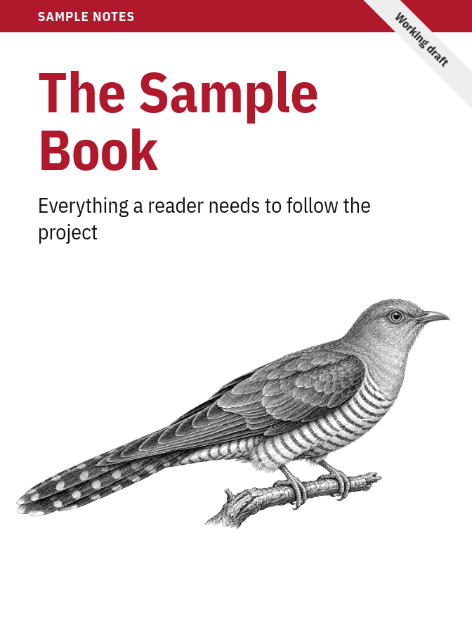
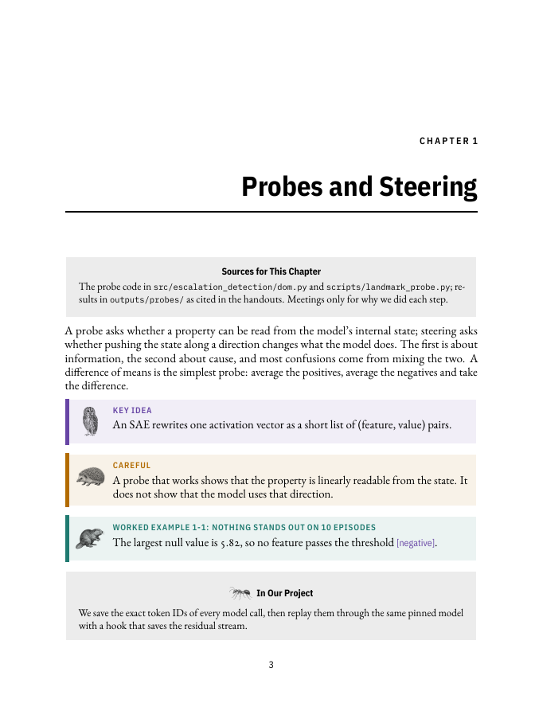

# animalbook

A Claude Code skill that writes a book about your project in the style of the
classic engraved-animal programming books. It plans the book with you, writes it
one part at a time from the project's own sources (code, outputs, meeting notes,
drafts, papers), keeps it up to date as the project moves, and lays it out with
an engraved animal on the cover.

<p>
  
  
</p>

The books are for learning and for keeping up with your own work. They are not
affiliated with any publisher, and no publisher's name or logo appears in them.

## What you get

- A cover in one of three layouts (`classic`, `modern`, `block`) with an animal
  picture: a real public-domain or openly licensed engraving from Wikimedia
  Commons when one fits, or one generated with Codex.
- 7 × 9.19 inch two-sided pages, serif text and condensed sans headings,
  right-aligned chapter openers, numbered figures, tables and code examples.
- Colored callouts in three styles (`tinted`, `icon`, `strip`): key idea,
  careful, worked example, questions, still to write. Gray sidebars for sources
  and "in our project" notes.
- Content rules that keep the book honest: every chapter says where its content
  comes from, numbers come only from files, results carry evidence tags.
- Updates: later runs find what changed since the last build and propose edits
  chapter by chapter.
- Recordings as sources: a class, talk or meeting on video becomes a transcript
  split by slide (with the slide PDF) or by screen change, with timestamps, so
  the book can cite what was said and when. Transcription runs on your machine
  with Whisper, or uses the Teams or Zoom `.vtt` export when there is one.

## Install

In Claude Code:

```
/plugin marketplace add afloresep/animalbook
/plugin install animalbook@animalbook
```

Then, in a project, ask for it: "make a book for this project", "update the
book" or "make a cover for the book".

## What it needs

On its first run on a machine the skill checks for everything below and tells you
the install command for anything missing. It never installs anything itself.

- LuaLaTeX with `fontspec`, `luaotfload`, `titlesec`, `tcolorbox`, `enumitem`,
  `imakeidx`, `pdfpages`, `listings`, `fancyhdr`, `caption` and TikZ. On
  Debian or Ubuntu: `sudo apt install texlive-luatex texlive-latex-extra
  texlive-pictures`.
- Poppler (`pdftoppm`, `pdfinfo`) and ImageMagick (`convert`).
- Chromium or Google Chrome, to draw the cover.
- Codex CLI, only for generated cover animals.
- Python 3.10 or newer. The scripts use the standard library only.
- ffmpeg and mlx-whisper, optional, only for recordings (Apple Silicon).

On macOS with Apple Silicon and no Homebrew or admin rights, one script
installs all of it except Chrome into `~/.animalbook` (TinyTeX, plus Python,
Poppler, ImageMagick and pytest from conda-forge through micromamba, about
850 MB), and adds `~/.animalbook/bin` to `PATH` in `~/.zshrc`. The skill points
to it on its first run when Homebrew is missing. Add `--video` to also install ffmpeg and
mlx-whisper with its speech model, for recordings (about 3.3 GB more). To
remove it all again, run `remove_env.sh`.

```
bash plugins/animalbook/skills/book/scripts/setup_env.sh
bash plugins/animalbook/skills/book/scripts/remove_env.sh
```

## How a book is laid out

A book lives in a folder inside your project, for example `docs/book/`:

```
docs/book/
├── book.json      the book's settings: title, look, parts, last build
├── book.tex       the main file
├── chapters/      one .tex file per chapter
├── figures/
├── cover/         the animal picture and the rendered cover
└── style/         the book's own copy of the style, fonts and icons
```

Each book keeps its own copy of the style, so it still builds the same way after
the skill changes.

## Tests

```
cd plugins/animalbook
python3 -m pytest skills/book/tests -q   # Python 3.10+; on macOS ~/.animalbook/conda/bin/python3
```

The build tests need LuaLaTeX and the fonts above.

## Licenses

The code, templates and icons are under the MIT License (`LICENSE`). The fonts in `plugins/animalbook/skills/book/assets/fonts/` are under the SIL Open
Font License; each family's license file sits next to it. The callout icons
were generated with Codex for this project. Cover pictures found on Commons
keep their own licenses, and the skill prints the credit line a license asks for.
